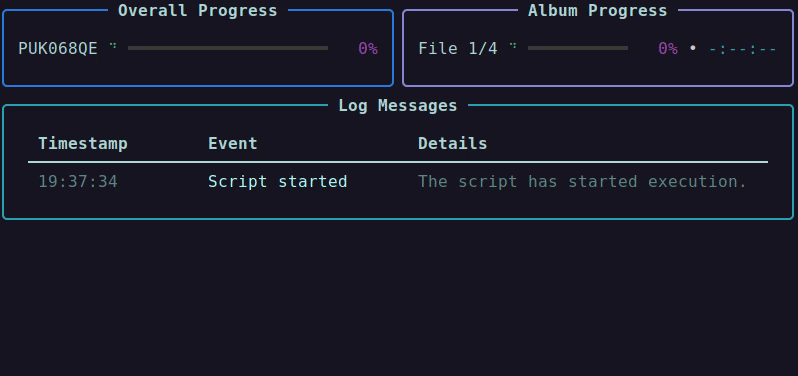

# Bunkr Downloader

> A Python Bunkr downloader that fetches images and videos from URLs. It supports both Bunkr albums and individual file URLs, logs issues, and enables concurrent downloads for efficiency.



## Features

- Downloads multiple files from an album concurrently.
- Supports [batch downloading](https://github.com/Lysagxra/BunkrDownloader?tab=readme-ov-file#batch-download) via a list of URLs.
- Supports [selective files downloading](https://github.com/Lysagxra/BunkrDownloader/tree/main?tab=readme-ov-file#selective-download) based on filename criteria.
- Supports [custom download location](https://github.com/Lysagxra/BunkrDownloader/tree/main?tab=readme-ov-file#file-download-location).
- Provides [minimal UI](https://github.com/Lysagxra/BunkrDownloader/tree/main?tab=readme-ov-file#disable-ui-for-notebooks) for notebook environments.
- Provides progress indication during downloads.
- Automatically creates a directory structure for organized storage.
- Logs URLs that encounter errors for troubleshooting.

## Dependencies

- Python 3.11+
- `BeautifulSoup` (bs4) - for HTML parsing
- `requests` - for HTTP requests
- `rich` - for progress display in the terminal

## Installation

Open a terminal in the folder where you want to install the tool, then follow the steps below.

1. Clone the repository:

```bash
git clone https://github.com/Lysagxra/BunkrDownloader.git
```

2. Navigate to the project directory:

```bash
cd BunkrDownloader
```

3. Install the required dependencies:

```bash
pip install -r requirements.txt
```

## Single Download

To download a single media from an URL, you can use `downloader.py`, running the script with a valid album or media URL.

### Usage

```bash
python3 downloader.py <bunkr_url>
```

### Examples

You can either download an entire album or a specific file:

```bash
python3 downloader.py https://bunkr.si/a/PUK068QE       # Download album
python3 downloader.py https://bunkr.fi/f/gBrv5f8tAGlGW  # Download single media
```

## Preserve original filenames

By default the downloader may generate filenames based on the URL. Use the `--clean-name` flag to preserve the original filename found on the item page.

### Usage

```bash
python3 downloader.py <bunkr_url> --clean-name
```

### Dry-run example

```bash
python3 downloader.py --dry-run --clean-name <bunkr_url>
```

## Selective Download

The script supports selective file downloads from an album, allowing you to exclude files using the [Ignore List](https://github.com/Lysagxra/BunkrDownloader?tab=readme-ov-file#ignore-list) and include specific files with the [Include List](https://github.com/Lysagxra/BunkrDownloader?tab=readme-ov-file#include-list).

## Ignore List

The Ignore List is specified using the `--ignore` argument in the command line.
This allows you to skip the download of any file from an album if its filename contains at least one of the specified strings in the list.
Item in the list should be separated by a space.

### Usage

```bash
python3 downloader.py <bunkr_album_url> --ignore <ignore_list>
```

### Example

This feature is particularly useful when you want to skip files with certain extensions, such as `.zip` files. For instance:

```bash
python3 downloader.py https://bunkr.si/a/PUK068QE --ignore .zip
```

## Include List

The Include List is specified using the `--include` argument in the command line.
This allows you to download a file from an album only if its filename contains at least one of the specified strings in the list.
Items in the list should be separated by a space.

### Usage

```bash
python3 downloader.py <bunkr_album_url> --include <include_list>
```

### Example

```bash
python3 downloader.py https://bunkr.si/a/PUK068QE --include FullSizeRender
```

## Batch Download

To batch download from multiple URLs, you can use the `main.py` script.
This script reads URLs from a file named `URLs.txt` and downloads each one using the media downloader.

### Usage

1. Create a file named `URLs.txt` in the root of your project, listing each URL on a new line.

- Example of `URLs.txt`:

```
https://bunkr.si/a/PUK068QE
https://bunkr.fi/f/gBrv5f8tAGlGW
https://bunkr.fi/a/kVYLh49Q
```

- Ensure that each URL is on its own line without any extra spaces.
- You can add as many URLs as you need, following the same format.

2. Run the batch download script:

```
python3 main.py
```

## File Download Location

If the `--custom-path <custom_path>` argument is used, the downloaded files will be saved in `<custom_path>/Downloads`.
Otherwise, the files will be saved in a `Downloads` folder created within the script's directory

Within that folder, each album gets its own `<album_title> (<album_id>)` subfolder. Use `--no-album-folder` to skip it and save the files directly into the download directory (`--no-download-folder` skips the `Downloads` folder itself; the two can be combined).

### Usage

```bash
python3 main.py --custom-path <custom_path>
```

## Disable UI for Notebooks

When the script is executed in a notebook environment (such as Jupyter), excessive output may lead to performance issues or crashes.

### Usage

You can run the script with the `--disable-ui` argument to disable the progress bar and minimize log messages.

To disable the UI, use the following command:

```
python3 main.py --disable-ui
```

## Maximum Number of Retries

If a download fails, the downloader will retry up to 5 times by default.
You can change the maximum number of retry attempts with the `--max-retries` argument.

### Usage

Allowed values: 0 (don't re-download) and larger.

```bash
python3 downloader.py <bunkr_url> --max-retries 3
```

## Logging

The application logs any issues encountered during the download process in a file named `session.log`.
Check this file for any URLs that may have been blocked or had errors.

### Resuming interrupted downloads

Single-connection downloads keep unfinished data in `<filename>.temp`, preserving
its extension (for example, `video.mp4.temp`). Run the same command again to request
the remaining bytes. A valid HTTP `206` response is appended only when its
`Content-Range` starts at the saved offset and describes the remaining tail.
Malformed or inconsistent range responses leave the partial file intact. If the
server returns a full `200` response instead, the partial is overwritten with that
full response. Short or interrupted responses are never renamed as completed files.

This complements the existing parallel `.partN` / `.bunkrparts` resume support.
Keep partial files and album state in the same download directory between runs.
Resume assumes the remote file has not changed; remove its partial files to start
over if the source was replaced or the server rejects the saved byte range.
Older partial files named by replacing the original extension are not reused.

### Session and diagnostic logs

Both entry points accept `--session-id <id>` to write structured session entries
to `session/<id>.log`, and `--verbose` to mirror UI events to a timestamped file in
`logs/`. Existing logs are retained. Without `--session-id`, the normal upstream
session log is used. These options also support `session_id` and `verbose` defaults
in `bunkr.toml`; explicit command-line values take precedence.

```bash
python downloader.py https://bunkr.cr/a/example --session-id example --verbose
python main.py --session-id batch --verbose
```

Session logs contain diagnostic records, rather than a list of direct URLs to
replay. Failed album items use upstream's final retry pass and persisted album
state. Re-run the original album command to retry remaining work in its original
directory. `--retries` remains an alias for upstream's `--max-retries` option.

Run the resume and session regression tests with:

```bash
python -m unittest discover -s tests -v
```
